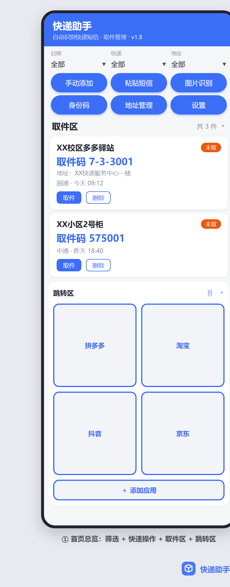
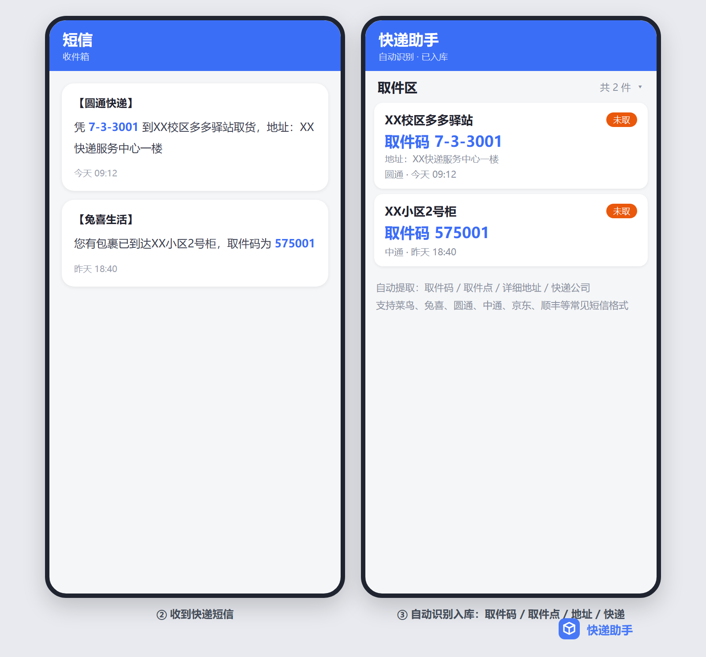
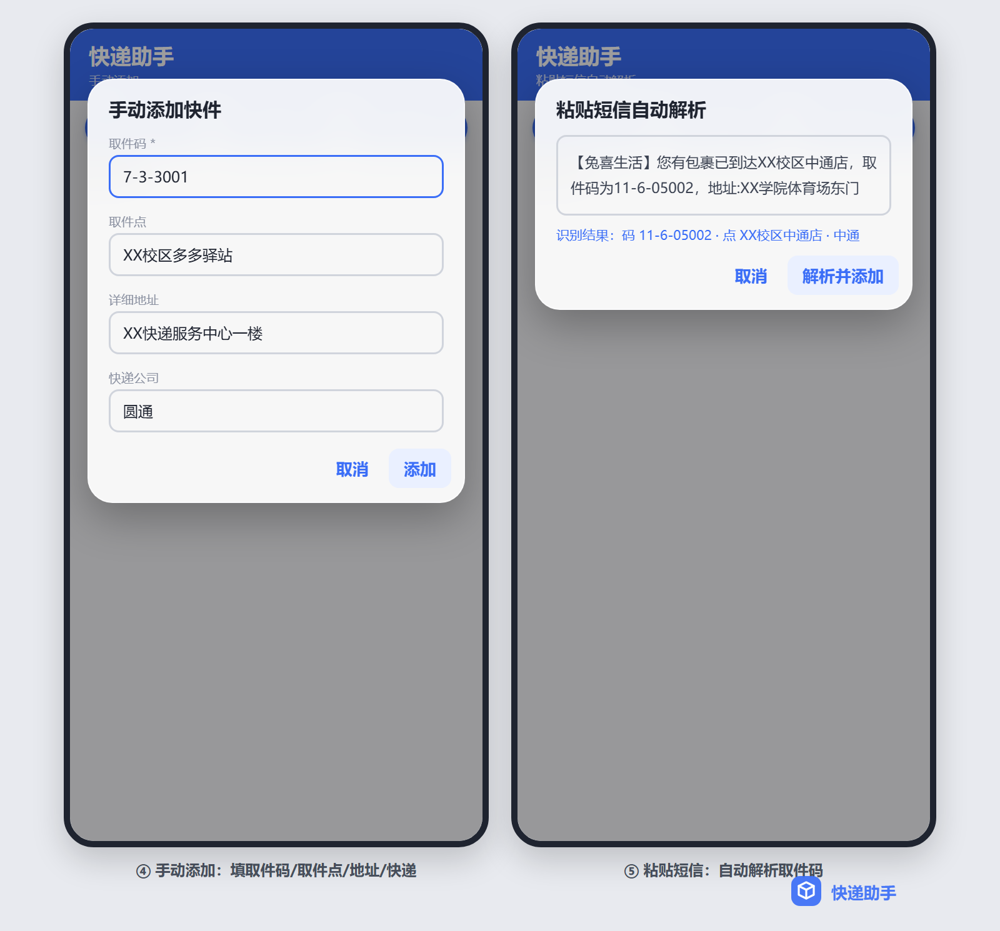
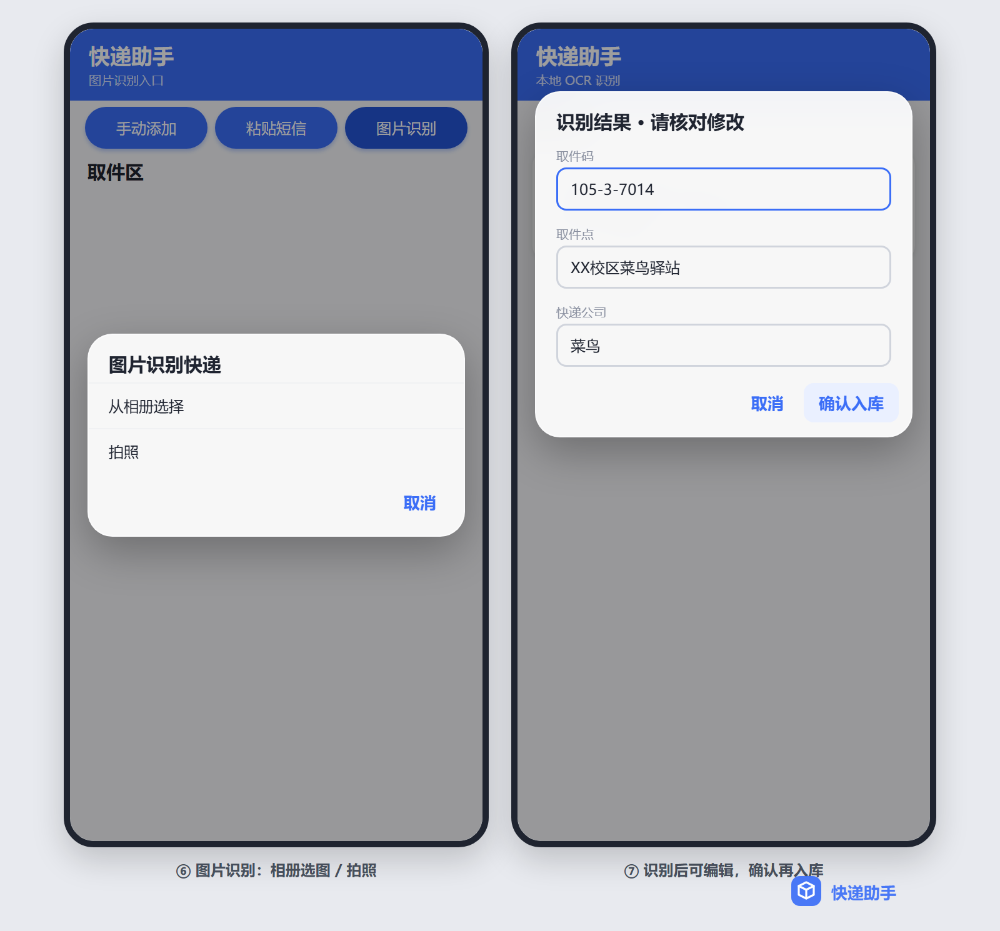
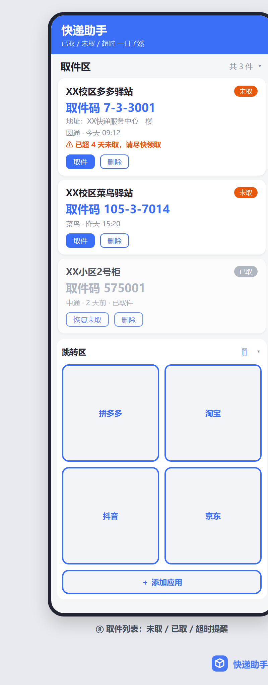
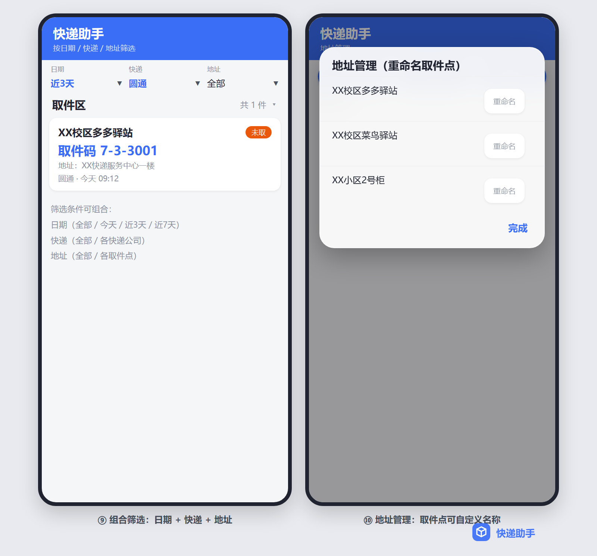
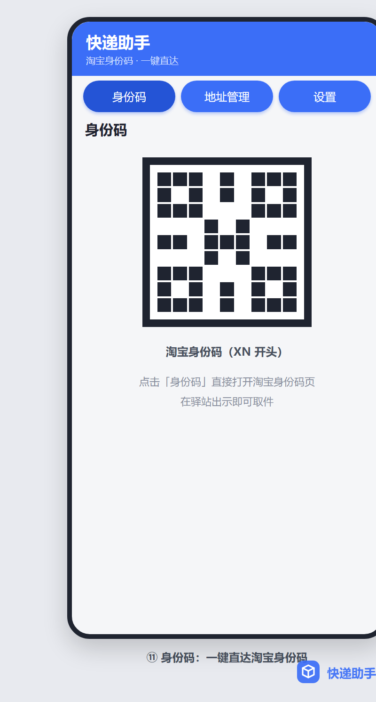
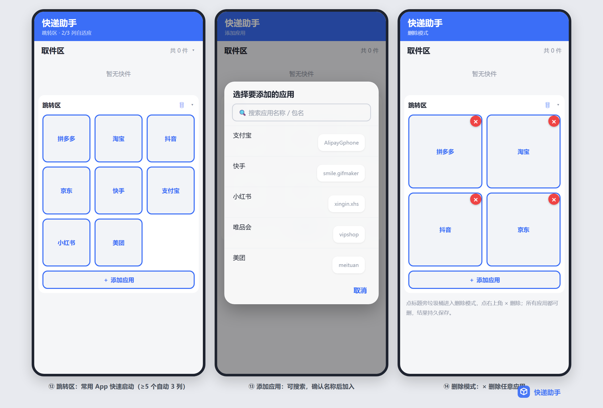
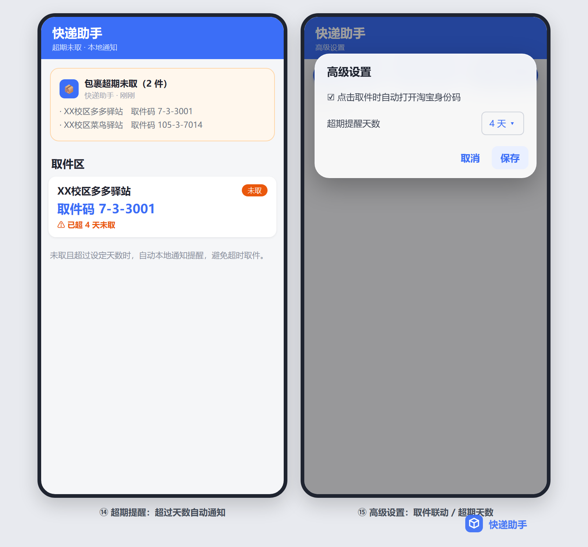

# Kuaidi Assistant (快递助手)

A native Android app for managing parcel pickups: **auto-reads delivery SMS → parses pickup code / pickup point / address / carrier → manages your pickup list → one-tap jump to shopping apps and Taobao identity code**.

> All data stays on-device (SharedPreferences). No upload. Sample data in this repository is anonymized.

[中文说明](README.md)

## Features

### Data entry
- **SMS auto-parse**: listens for delivery SMS in the background and stores parsed packages automatically
- **Paste SMS**: paste any delivery SMS to extract the pickup code
- **Manual add**: pickup code / pickup point / address / carrier
- **Image OCR**: pick a screenshot from gallery or take a photo; offline Chinese OCR (ML Kit) extracts the text, with editable preview before saving
- **Broad format support**: Cainiao, Tuxi, YTO, ZTO, JD, SF Express, J&T, Yunda, STO, EMS, Deppon, Best, etc.

### Pickup management
- Picked / not-picked status with one-tap toggle
- **Overdue reminder**: local notification when unpicked beyond a configurable threshold (3 / 4 / 5 / 7 days)
- **Combined filters**: by date (today / last 3 days / last 7 days), carrier, pickup address
- **Address aliases**: rename pickup points (e.g. `XX Campus Duoduo Station` → `Duoduo Station`)

### Quick launch
- **Jump area**: one-tap launch of Pinduoduo / Taobao / Douyin / JD and custom apps
- **Adaptive grid**: 2 columns for ≤4 apps, 3 columns for ≥5 apps (max 3 per row)
- **Add app**: choose from installed apps, searchable, confirm the display name
- **Delete mode**: tap the trash icon next to the section title, then tap the `×` on any app to remove it (persisted)
- **Taobao**: tapping it offers `Launch Taobao` / `Identity code`
- **Identity code**: deep-links to the Taobao identity code page (starts with `XN`)

### UI
- Collapsible pickup / jump sections
- All dialogs use **rounded corners + translucent frosted glass** (real background blur on Android 12+)
- Material3 DayNight theme

## Screenshots

| | | |
|---|---|---|
|  |  |  |
| Home overview | SMS auto-parse | Manual add / paste SMS |
|  |  |  |
| Image OCR | Pickup list | Filters + address aliases |
|  |  |  |
| Identity code | Jump area / delete mode | Overdue reminder / settings |

## Requirements

- JDK 17
- Android SDK (compileSdk 34 / minSdk 26)
- Gradle 8.7

## Build

### Android Studio (recommended)
1. `File → Open` and select this directory
2. Wait for Gradle sync
3. `Build → Build Bundle(s)/APK(s) → Build APK(s)`
4. Output: `app/build/outputs/apk/debug/app-debug.apk`

### Command line
This repository does not bundle the Gradle Wrapper. Use a local **Gradle 8.7**:
```bash
gradle assembleDebug
```

> For CI, the [`Build APK`](.github/workflows/android.yml) workflow builds the APK automatically on every push to `main`.

## Permissions

| Permission | Purpose |
|---|---|
| `RECEIVE_SMS` / `READ_SMS` | Auto-read delivery SMS in the background |
| `POST_NOTIFICATIONS` | Overdue pickup reminders |
| `<queries>` (package visibility) | Query / launch Taobao, Pinduoduo, Douyin, JD, etc. |

## Privacy

- All package data is stored locally in `SharedPreferences`; nothing is uploaded
- Sample station names, addresses and pickup codes in this repo are **fictional / anonymized** (e.g. `XX Campus Duoduo Station`)
- No phone numbers, real addresses, signing keys or local paths are included

## Tech stack

- Kotlin + AndroidX + Material3
- RecyclerView / ConstraintLayout
- AlarmManager (overdue check)
- ML Kit Chinese text recognition (offline OCR)
- BroadcastReceiver (SMS listener)

## License

[MIT](LICENSE)
