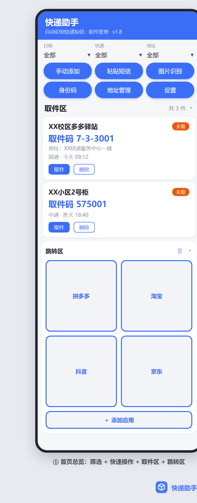
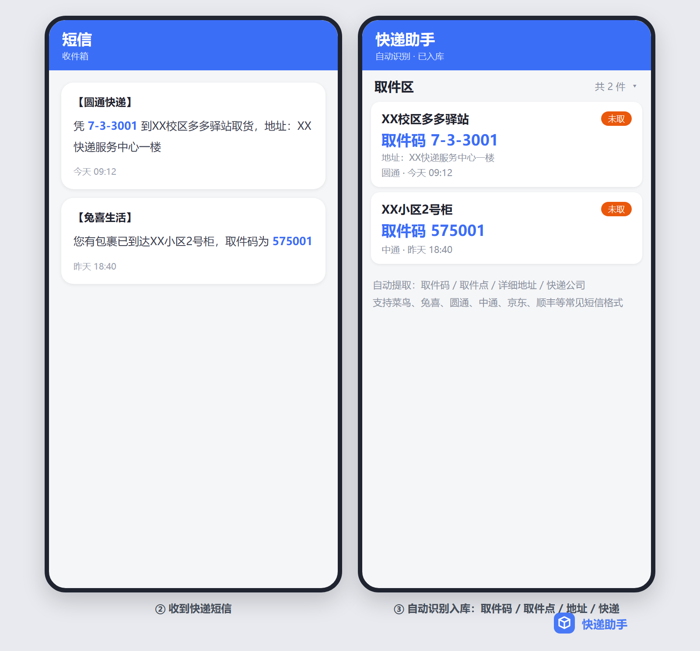
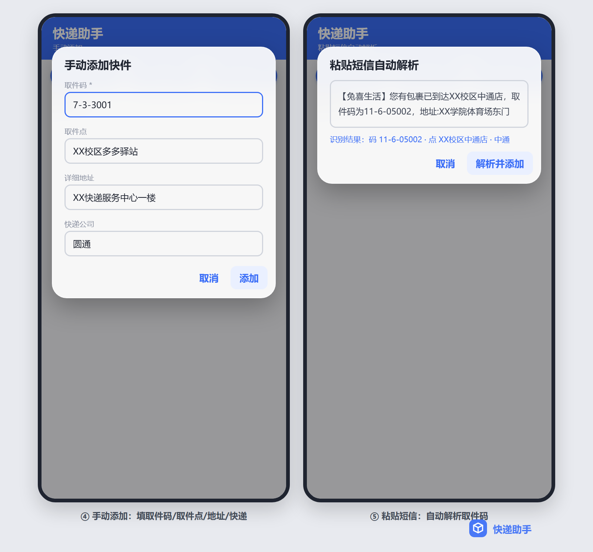
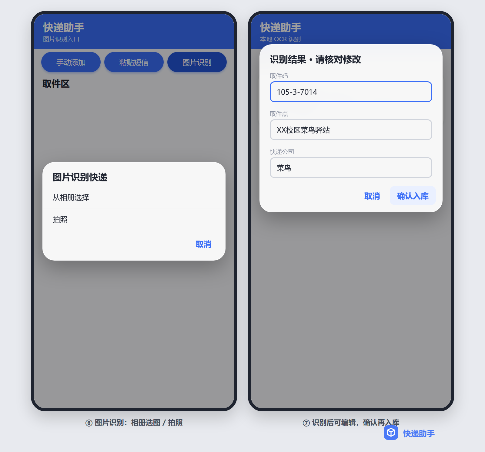
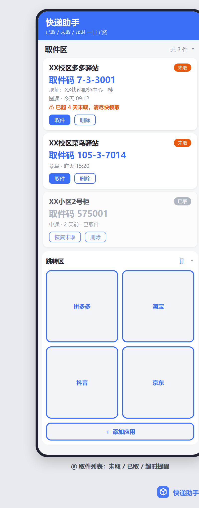
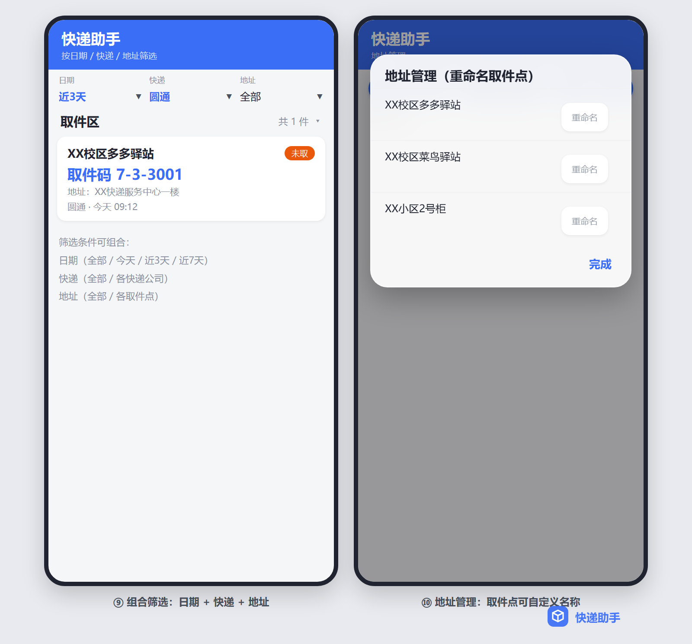
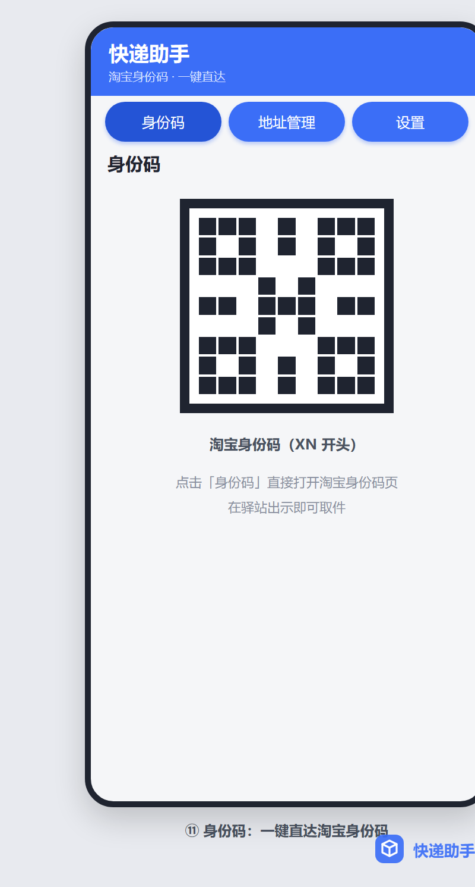
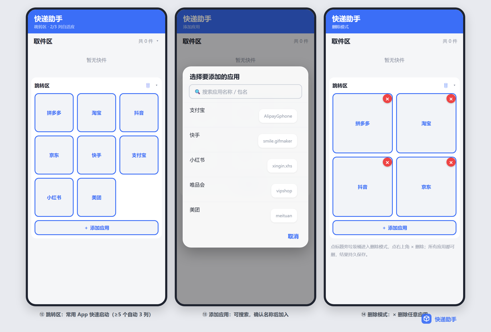
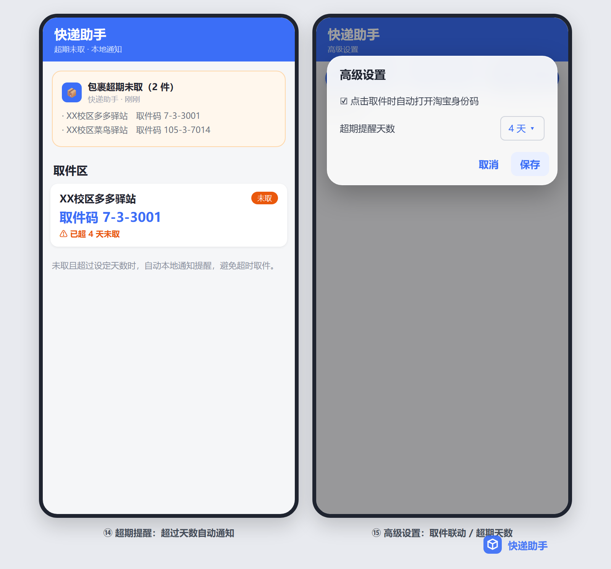

# 快递助手 Kuaidi Assistant

原生 Android 快递取件管理 App：**自动读取快递短信 → 解析取件码/取件点/地址/快递公司 → 列表管理 → 一键跳转取件应用与身份码**。

> 数据全部保存在手机本地（SharedPreferences），不联网上传。
> 本仓库中的示例数据均已脱敏处理。

## 功能总览

### 录入方式
- **短信自动识别**：后台监听快递短信，自动解析入库（无需手动操作）
- **粘贴短信**：粘贴任意快递短信，自动解析取件码
- **手动添加**：手动填写取件码 / 取件点 / 地址 / 快递公司
- **图片识别**：相册选图或拍照，本地离线 OCR（ML Kit 中文）识别短信截图，可编辑确认后入库
- **规则覆盖**：菜鸟、兔喜、圆通、中通、京东、顺丰、极兔、韵达、申通、邮政/EMS、德邦、百世等常见短信格式

### 取件管理
- 未取 / 已取状态，支持一键标记与撤销
- **超期提醒**：未取超过设定天数（3/4/5/7 天可配置）自动本地通知
- **组合筛选**：按日期（今天/近3天/近7天）、快递公司、取件地址筛选
- **地址管理**：给取件点自定义别名（如「XX校区多多驿站」→「多多驿站」）

### 快捷跳转
- **跳转区**：拼多多 / 淘宝 / 抖音 / 京东 等常用 App 一键启动
- **自适应布局**：≤4 个应用用 2 列，≥5 个自动 3 列（最多 3 列）
- **添加应用**：从手机已安装应用中选择，支持搜索，确认名称后加入跳转区
- **删除模式**：点跳转区标题旁垃圾桶图标进入删除模式，点应用右上角 × 删除（所有应用可删，结果持久保存）
- **淘宝**：点淘宝弹出「启动淘宝 / 身份码」二选一
- **身份码**：一键直达淘宝身份码页（XN 开头，供驿站扫码取件）

### 界面
- 取件区 / 跳转区均可折叠
- 全部弹窗统一**圆角 + 透明磨砂**（Android 12+ 叠加真实背景模糊）
- 支持深色模式（Material3 DayNight）

## 效果图

| | | |
|---|---|---|
|  |  |  |
| 首页总览 | 短信自动识别 | 手动添加 / 粘贴短信 |
|  |  |  |
| 图片识别（OCR） | 取件列表 | 筛选 + 地址管理 |
|  |  |  |
| 身份码 | 跳转区 / 删除模式 | 超期提醒 / 设置 |

## 环境要求

- JDK 17
- Android SDK（compileSdk 34 / minSdk 26）
- Gradle 8.7（仓库自带 wrapper 或使用 Android Studio）

## 构建

### Android Studio（推荐）
1. `File → Open` 选择本目录
2. 等待 Gradle Sync
3. `Build → Build Bundle(s)/APK(s) → Build APK(s)`
4. 产物：`app/build/outputs/apk/debug/app-debug.apk`

### 命令行
```bash
./gradlew assembleDebug      # Linux / macOS
gradlew.bat assembleDebug    # Windows
```

> 首次构建前需要在 `local.properties` 中配置 `sdk.dir`（Android Studio 会自动生成）。

## 权限说明

| 权限 | 用途 |
|---|---|
| `RECEIVE_SMS` / `READ_SMS` | 后台自动读取快递短信 |
| `POST_NOTIFICATIONS` | 超期未取提醒 |
| `<queries>`（包可见性） | 查询/启动淘宝、拼多多、抖音、京东等应用 |

## 隐私与脱敏

- 所有包裹数据仅存储于本机 `SharedPreferences`，**不上传服务器**
- 仓库内示例中的驿站名、地址、取件码均为**虚构/脱敏数据**（如 `XX校区多多驿站`）
- 不包含任何个人手机号、真实地址、签名密钥或本机路径

## 技术栈

- Kotlin + AndroidX + Material3
- RecyclerView / ConstraintLayout
- AlarmManager（超期定时检查）
- ML Kit 中文文本识别（本地离线 OCR）
- BroadcastReceiver（短信监听）

## 许可证

[MIT](LICENSE)
